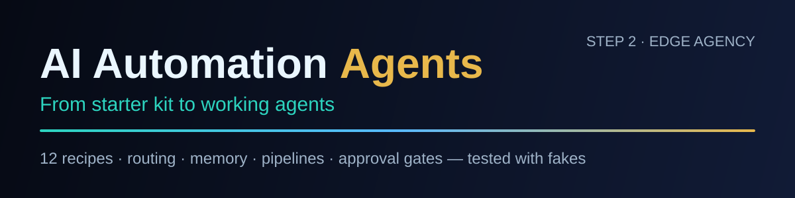

<p align="center">
  
</p>

<h1 align="center">AI Automation Agents</h1>

<p align="center">
  <strong>Build working AI agents — twelve production-pattern recipes with routing, memory, pipelines, and approval gates.</strong>
</p>

<p align="center">
  
</p>

<p align="center">
  <a href="https://github.com/EdgeAgent/ai-automation-agents/actions/workflows/ci.yml"></a>
  <a href="https://www.python.org/"></a>
  
  
  <a href="LICENSE"></a>
</p>

**Step 2 of the AI Automation series.** [Step 1 — the AI Automation Starter Kit](https://github.com/EdgeAgent/ai-automation-starter) gave you the foundation: a lean Python toolbox, install profiles, and a runnable job service. This repository is what you build on it: twelve agent recipes that run, each tested end to end with fakes — no network, no API keys, no paid model calls.

> These are production *patterns* in runnable form, not a hosted service and not a turnkey deployment. Recipes draft, score, summarize, and propose; sending, posting, and executing stay behind human approval, and credentials, infrastructure security, and production operations remain your responsibility.

## What you can do

- Run **twelve recipes** in a numbered build order — deterministic ones first (no model needed), provider recipes next, orchestration last.
- Chain recipes into **pipelines**: web-research → scheduled digest, and inbox-triage → lead-responder ship as working, tested reference pipelines.
- Let the **router** take a natural-language task ("clean and dedupe this CSV of leads") and route it to the right recipe — deterministic keyword routing by default, provider-pluggable when you want a model to choose.
- Give recipes a **shared memory**: a small local JSON store any recipe can read/write, so the lead responder remembers prior contact and the reporter remembers its last run.
- Gate side effects with **approval gates**: propose → approve/deny → execute, with a tamper-evident, hash-chained receipt log.
- Run everything from the `ai-agents` CLI on fakes: `ai-agents recipes`, `ai-agents run inbox-triage --demo`, `ai-agents demo`.
- Add **Recipe 13 — yours** — by following the guide in [`docs/build-your-own-recipe.md`](docs/build-your-own-recipe.md).

## The twelve recipes

Numbered in build order — a learning path, not just a list. Start at 01: the deterministic recipes need no provider at all, so you can run them the minute the repo is cloned.

| # | Recipe | What it does | Provider needed | Sends anything? |
| --- | --- | --- | --- | --- |
| 01 | `lead-list-cleaner` | Dedupe a lead CSV, flag bad contacts, grade every row A/B/C | None | No — local only |
| 02 | `quote-drafter` | Itemized quote with tax, totals, and a deposit split | None | No — local only |
| 03 | `doc-qa` | Answer questions over local documents, with cited sources | None (embedder optional) | No — local only |
| 04 | `support-faq` | FAQ answers with citations and an escalate-to-human path | None | No — draft-only |
| 05 | `scheduled-reporter` | Build a digest from structured inputs on a schedule, with run memory | None | No — local only |
| 06 | `approval-gated-actor` | Propose actions → human approval → execute, with tamper-evident receipts | None | Gated — approved actions only, via your executor |
| 07 | `inbox-triage` | Classify incoming messages (urgent/routine/spam) and draft replies | Chat | No — draft-only |
| 08 | `lead-responder` | Score leads against criteria; draft approval-gated follow-ups; remembers prior contact | Chat | No — draft-only |
| 09 | `meeting-notes` | Decisions, action items with owners, and a follow-up draft from a transcript | Chat | No — draft-only |
| 10 | `social-drafter` | Draft post variants + hashtags per platform, checked against character limits | Chat | No — draft-only |
| 11 | `web-research` | Fetch pages, extract text, summarize with a full source list | Chat + HTTP | No — reads only |
| 12 | `code-review` | Structured findings from a diff: file, line, severity, message | Chat | No — comments only |

Then the orchestration layer ties them together: the **router** (routing), the **shared memory** (memory), and the **pipelines** (composition). Recipe 13 is yours.

## Quick start

You need Python 3.11+. No API key is needed for anything below — demos and tests run on fakes.

```bash
git clone https://github.com/EdgeAgent/ai-automation-agents.git
cd ai-automation-agents
python -m pip install -e ".[dev]"
```

```bash
ai-agents recipes                          # the twelve, in build order
ai-agents run lead-list-cleaner --demo     # one recipe, end to end
ai-agents run approval-gated-actor --demo  # the safety pattern, live
ai-agents pipeline research-digest --demo  # web-research → reporter
ai-agents demo                             # headline recipes + both pipelines
```

For live runs, install the provider profile and wire a real provider in code (see [`docs/architecture.md`](docs/architecture.md)):

```bash
python -m pip install -e ".[openai,dev]"
```

Copy `.env.example` to `.env` and set `OPENAI_API_KEY` only when you actually run a live provider. Never commit `.env`.

## The recipes, one by one

### Recipe 01 — Lead-list cleaner

CSV in → cleaned CSV out, in pure standard library. Dedupe by normalized email (phone fallback), validate contacts, flag problems per row, grade A (ready) / B (usable) / C (incomplete). This is the recipe pattern at its simplest: typed input, typed output, statistics you can audit.

```python
from ai_automation_agents.recipes.lead_cleaner import clean_leads

result = clean_leads(open("leads.csv").read())
print(result.stats)  # {'input_rows': ..., 'grade_a': ..., ...}
print(result.cleaned_csv)  # the cleaned, graded CSV
```

Sample input and expected output: [`examples/lead-list-cleaner/`](examples/lead-list-cleaner/).

### Recipe 02 — Quote drafter

Job details in → an itemized quote out, computed in `Decimal`: line items, labor, markup, tax, totals, and a deposit/balance split that always sums to the total. Money math is deterministic on purpose — a quote should be recomputable cent-for-cent.

```python
from decimal import Decimal
from ai_automation_agents.recipes.quote_drafter import QuoteItem, QuoteRequest, build_quote

quote = build_quote(
    QuoteRequest(
        client="Riverside Dental",
        items=[QuoteItem(description="AI receptionist setup", unit_price=Decimal("400"))],
        tax_rate=Decimal("13"),
        deposit_percent=Decimal("30"),
    )
)
print(quote.render())
```

Sample input and expected output: [`examples/quote-drafter/`](examples/quote-drafter/).

### Recipe 03 — Document Q&A

Answers over a small local document set. Keyword retrieval by default; plug in an embedder and it ranks by cosine similarity instead. Answers are extractive and cited (`[pricing]`), and when nothing clears the relevance threshold the agent says "I don't know" and escalates rather than inventing.

```python
from ai_automation_agents.recipes.doc_qa import DocQAAgent
from ai_automation_agents.retrieval import Document

agent = DocQAAgent([Document(id="pricing", title="Pricing", text="The first pack costs $50.")])
print(agent.answer("How much does the first pack cost?").text)
```

Sample documents and expected answers: [`examples/doc-qa/`](examples/doc-qa/).

### Recipe 04 — Support FAQ agent

The support-shaped sibling of doc-qa: a curated FAQ set, an approved answer with a citation for every match, and an explicit "I don't know → escalate to a human" path. The escalation is a feature, not a failure — it is what makes the answers safe to use.

### Recipe 05 — Scheduled reporter

A pure-function core (structured sections in, Markdown digest out) plus a thin reporter/scheduler layer: the reporter records each run in shared memory, and the scheduler runs it only when the interval has elapsed. Clock and memory are injected, so the schedule pattern is testable without sleeping.

### Recipe 06 — Approval-gated actor

The safety pattern as a reusable component, in `ai_automation_agents.approval`: an agent proposes an action, a human approves or denies it, only approved actions execute (through *your* injected executor), and every step lands in a hash-chained receipt log that fails verification if history is edited. Recipes 07–12 draft; this is the gate you put in front of anything that acts.

```python
from ai_automation_agents.approval import ApprovalGate
from ai_automation_agents.fakes import FakeExecutor

gate = ApprovalGate()
proposal = gate.propose("send_report", {"to": "team@example.com"}, reason="Digest is ready")
gate.approve(proposal.id)  # a human decision
gate.execute(proposal.id, FakeExecutor())  # only now does anything run
assert gate.log.verify()  # receipts are tamper-evident
```

### Recipe 07 — Inbox triage

Classifies a batch of messages as urgent, routine, or spam through the injected chat provider, drafts a reply for everything that deserves one, and returns a handoff list. There is deliberately no send path in the module.

Sample messages and the expected handoff: [`examples/inbox-triage/`](examples/inbox-triage/).

### Recipe 08 — Lead responder

Scores a lead against your criteria with transparent points (budget fit, keyword matches, location — each reason printed), drafts a follow-up, and holds it at `draft` status until a human approves. Shared memory records every contact, so a returning lead is recognized and framed as a follow-up.

### Recipe 09 — Meeting-notes agent

Transcript in → decisions, action items with owners and due dates, open questions, and a follow-up draft out. The provider answers with a strict JSON contract; malformed output degrades to an empty structure with a warning, never to invented content.

### Recipe 10 — Social-content drafter

Topic + platform in → up to three draft variants with hashtags out, each checked against the platform's character limit and flagged when over. Draft-only: there is no posting path.

### Recipe 11 — Web-research agent

Question + URLs in → a sourced summary out. Pages are fetched through the injected HTTP client, reduced to text with the standard library, and summarized by the provider. Fetch failures are recorded as failed sources in the report — never silently dropped.

### Recipe 12 — Code-review assistant

Diff in → structured findings out (file, line, severity, category, message), counted by severity and rendered grouped. It comments on code; it never edits, commits, or merges.

## Pipelines

Pipelines chain recipes so one output feeds the next. Two reference pipelines ship and are covered by tests:

- **`research-digest`** — web-research → scheduled-reporter: research a question, then fold the summary and source list into a scheduled digest (the run is recorded in memory like any other). Walkthrough: [`docs/pipeline-research-digest.md`](docs/pipeline-research-digest.md).
- **`triage-leads`** — inbox-triage → lead-responder: triage the inbox, then score and draft follow-ups for messages carrying lead data. Spam is counted and skipped before it can reach the responder; every draft stays a draft. Walkthrough: [`docs/pipeline-triage-leads.md`](docs/pipeline-triage-leads.md).

```bash
ai-agents pipeline research-digest --demo
ai-agents pipeline triage-leads --demo
```

## Routing and memory

**Routing.** `Router` turns a task sentence into a recipe choice. Default routing is deterministic keyword scoring over the registry — transparent and testable. Inject a chat provider and the model picks from the registry instead, with the keyword scorer as fallback when the model answers nonsense.

```python
from ai_automation_agents.router import Router

print(Router().route("Please clean and dedupe this CSV of leads").recipe)
# → lead-list-cleaner
```

**Memory.** `MemoryStore` is one JSON file (or in-memory) with namespaced keys:

```python
from ai_automation_agents.memory import MemoryStore

memory = MemoryStore(".ai-agents-memory.json")
memory.set("lead-responder", "contacts:lead-dana", 2)
memory.append("scheduled-reporter", "history", {"run": 3})
```

How recipes, router, memory, and providers fit together: [`docs/architecture.md`](docs/architecture.md).

## Develop and test

```bash
python -m pip install -e ".[openai,dev]"
ruff check .
ruff format --check .
pytest
```

The tests inject fake providers, a fake HTTP client, and a fake embedder. They make no network calls, need no API keys, and spend no money. The GitHub Actions workflow runs the same checks on Python 3.11, 3.12, and 3.13. A standalone demo script lives at [`scripts/demo.py`](scripts/demo.py).

## What this does — and does not do

The recipes are real, runnable implementations of the patterns, verified by their tests on fakes. The provider boundary is the honest seam: swap `FakeChatProvider` for `OpenAIChatProvider` (or your own adapter) and the same recipe code runs live — but *your* deployment owns prompt quality, rate limits, cost controls, and output review.

Nothing here sends email, posts to social media, or executes actions on its own. Drafting recipes stop at drafts; the one executing component (Recipe 06) runs only human-approved actions through an executor you supply. The keyword retriever is transparent and fine for small local sets; it is not a vector database. The router's keyword mode is a heuristic — it will misroute ambiguous tasks, which is why routing returns a decision for review rather than silently executing. Provider output is parsed defensively and degrades to warnings or escalation, but a live model can still produce plausible nonsense: keep a human in the loop wherever the output matters.

## Repository layout

```text
.
├── .github/workflows/ci.yml        # Python matrix tests and package build
├── assets/                         # Icon, banner, and social preview (SVG)
├── docs/                           # Architecture, Recipe 13 guide, pipeline walkthroughs
├── examples/                       # Sample inputs + expected outputs for four recipes
├── scripts/demo.py                 # Standalone end-to-end demo on fakes
├── src/ai_automation_agents/
│   ├── providers.py                # Chat / HTTP / embedder / executor interfaces + adapters
│   ├── fakes.py                    # Scripted fakes used by demos and tests
│   ├── memory.py                   # Shared JSON memory store
│   ├── approval.py                 # Approval gate + hash-chained receipt log
│   ├── retrieval.py                # Keyword / embedding retrieval for doc recipes
│   ├── router.py                   # Recipe registry + task router
│   ├── pipelines.py                # The two reference pipelines
│   ├── demo_data.py / demo.py      # Sample inputs and demo runners
│   ├── cli.py                      # The ai-agents CLI
│   └── recipes/                    # Recipes 01–12, one module each
├── tests/                          # Fakes-first tests for everything above
├── PUBLISHING.md                   # Repo description + topics for publish time
└── pyproject.toml                  # Package metadata and install profiles
```

## Contributing

Install the development profile, run the checks above, and keep the default install lean. When adding a recipe, follow [`docs/build-your-own-recipe.md`](docs/build-your-own-recipe.md) — typed input/output, provider behind an interface, tests on fakes, and a registry entry. See [`CONTRIBUTING.md`](CONTRIBUTING.md).

## Repository and license

Step 1: [github.com/EdgeAgent/ai-automation-starter](https://github.com/EdgeAgent/ai-automation-starter). This repository is not published to PyPI; clone it and use the editable install commands above. Released under the [MIT License](LICENSE). Publishing notes (description, topics, social preview) live in [`PUBLISHING.md`](PUBLISHING.md).
